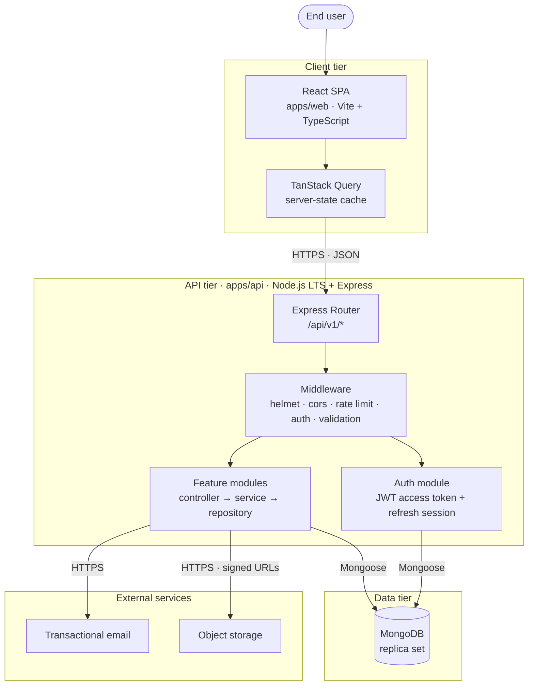
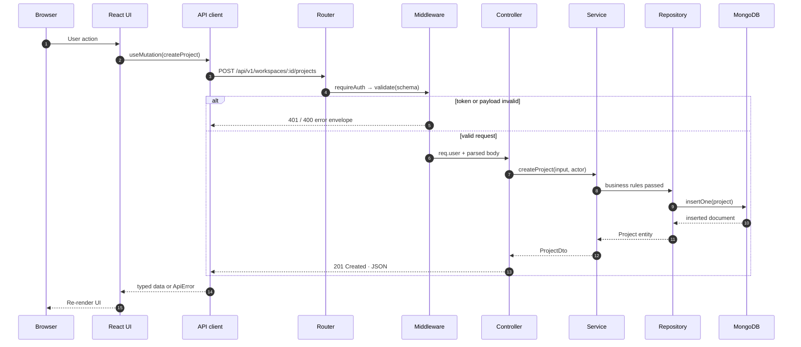
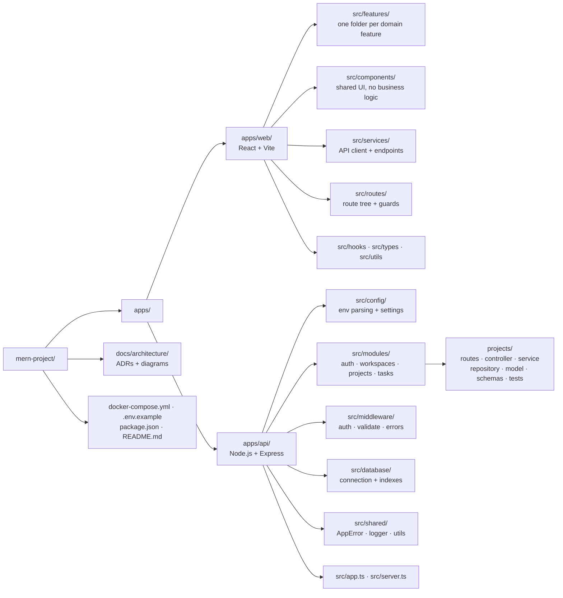
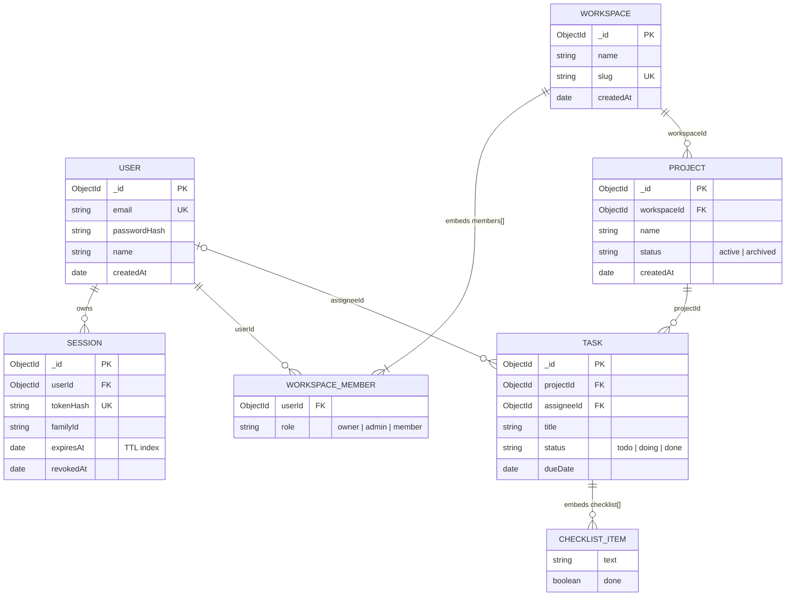
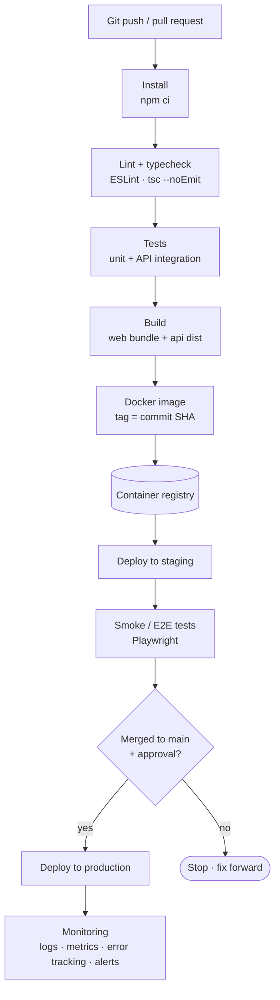
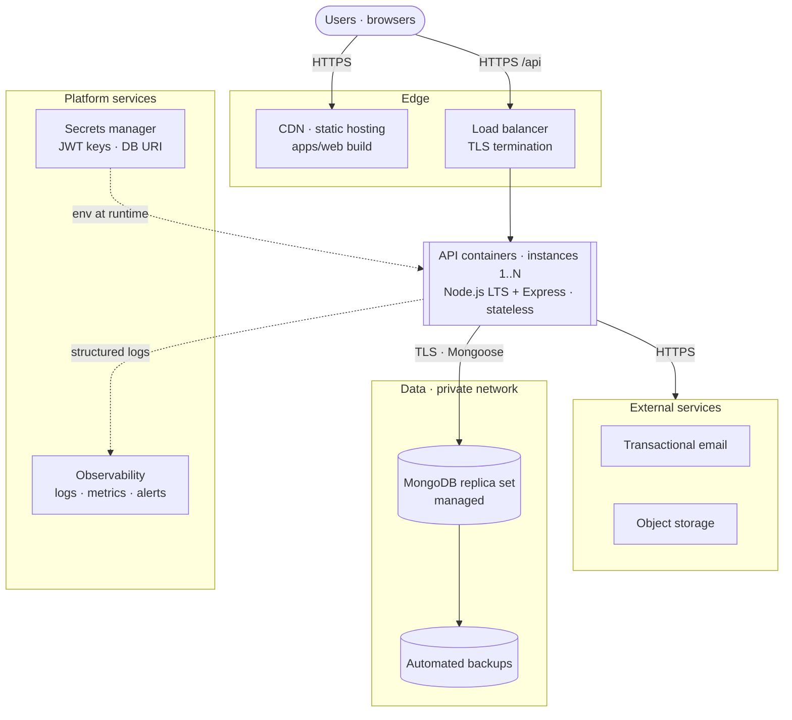
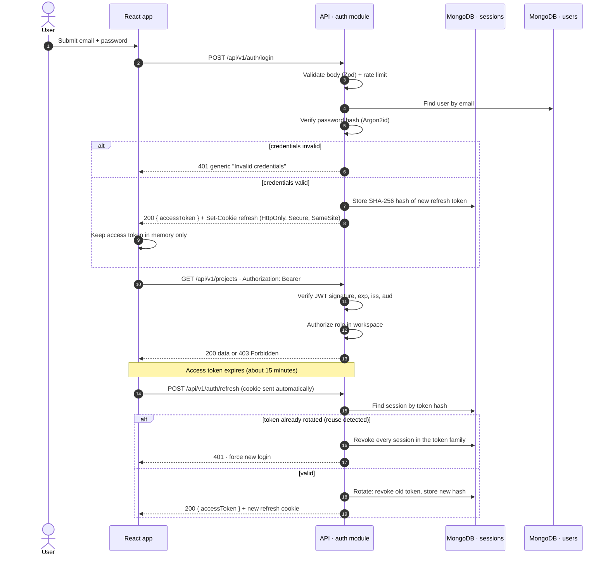

# MERN Stack Project — Reference Architecture

> Reference documentation for a production-grade **MongoDB · Express · React · Node.js** application written in TypeScript.
> Companion to the article [How to Start a MERN Stack Project: Architecture, Structure & Best Practices](https://brick-mortar.com.mx/en/blog/mern-stack-project) by [Brick & Mortar](https://brick-mortar.com.mx/en).

This repository is **documentation, not a finished application**. It defines the architecture, conventions and acceptance criteria that a team — or an AI coding agent such as Claude Code, Codex CLI or Cursor Agent — should follow to implement the project. Every code sample referenced here was type-checked and tested against the versions listed below.

**Example domain:** a multi-tenant project tracker. Users belong to *workspaces*; workspaces contain *projects*; projects contain *tasks*.

---

## Table of contents

1. [Project overview](#project-overview)
2. [Technology stack](#technology-stack)
3. [Architecture overview](#architecture-overview)
4. [Folder structure](#folder-structure)
5. [Data model](#data-model)
6. [Installation](#installation)
7. [Environment variables](#environment-variables)
8. [Development commands](#development-commands)
9. [API overview](#api-overview)
10. [Testing](#testing)
11. [Docker setup](#docker-setup)
12. [Deployment](#deployment)
13. [Security considerations](#security-considerations)
14. [AI Coding Agent Instructions](#ai-coding-agent-instructions)

---

## Project overview

| Item | Decision |
| --- | --- |
| Repository layout | Monorepo with npm workspaces: `apps/web` and `apps/api` |
| Frontend | React single-page app built with Vite, written in TypeScript |
| Backend | REST API on Node.js LTS + Express 5, modular by feature |
| Database | MongoDB (replica set) accessed through Mongoose |
| Auth | Short-lived JWT access token (in memory) + rotating refresh token (HttpOnly cookie) |
| Validation | Zod at every API boundary; same error envelope for every failure |
| Delivery | GitHub Actions → container image → staging → production |

## Technology stack

Versions verified in November 2026. Pin exact versions in `package-lock.json` and upgrade deliberately.

### Required

| Layer | Tool | Why |
| --- | --- | --- |
| Runtime | **Node.js 26 LTS** (24 LTS also supported) | Long-term support release line; native `fetch`, `--watch`, `--env-file` |
| Language | **TypeScript 7** | Shared types across the stack, safer refactors |
| API framework | **Express 5** | Rejected promises in async handlers reach the error handler automatically |
| Database | **MongoDB 8** | Document model, replica sets, transactions, TTL indexes |
| ODM | **Mongoose 9** | Schemas, validation, indexes and typed models on top of the driver |
| Validation | **Zod 4** | One schema = runtime validation + static type |
| Frontend | **React 19** + **Vite 8** | Fast dev server and production builds |
| Server state | **TanStack Query 5** | Caching, deduplication, retries, invalidation |
| Auth | **jose** (JWT) + **argon2** (password hashing) | Maintained, standards-based, Argon2id recommended by OWASP |
| Tests | **Vitest 5**, **Supertest**, **mongodb-memory-server** | Fast unit + API integration tests against a real MongoDB |
| Quality | **ESLint 10** + **typescript-eslint** | Catches bugs and enforces the dependency rules in CI |
| Dev runner | **tsx** | Runs and watches the TypeScript API in development |
| Containers | **Docker** + Docker Compose | Identical local and production runtime |
| CI/CD | **GitHub Actions** | Lint, typecheck, test, build, image, deploy |

### Optional (add when the need is real)

| Tool | Add it when |
| --- | --- |
| React Router or TanStack Router | The web app has more than a couple of screens |
| React Hook Form | Forms have many fields or complex validation |
| Playwright | You want end-to-end smoke tests against staging |
| MSW | Frontend tests need realistic API mocks |
| OpenTelemetry | You need distributed tracing across services |
| Error tracking (e.g. Sentry) | You run in production with real users |
| Redis | You need shared rate limiting, caching or queues across API instances |

## Architecture overview



### Request lifecycle

Every request follows the same path. Each layer has exactly one job.



| Layer | Responsibility | Must not |
| --- | --- | --- |
| Router | Map HTTP method + path to middleware and controller | Contain logic |
| Middleware | Cross-cutting concerns: auth, validation, rate limiting, logging | Know about specific features |
| Controller | Translate HTTP ↔ service call, choose status code | Access the database or apply business rules |
| Service | Business rules, authorization decisions, orchestration | Import Express or read `req`/`res` |
| Repository | Persistence through Mongoose | Apply business rules or throw HTTP errors |

## Folder structure



```text
mern-project/
├── apps/
│   ├── web/                          # React + Vite
│   │   ├── src/
│   │   │   ├── components/           # Shared, presentational UI
│   │   │   ├── features/             # One folder per domain feature (projects, tasks...)
│   │   │   ├── hooks/                # Cross-feature hooks
│   │   │   ├── services/             # API client
│   │   │   ├── routes/               # Route tree and guards
│   │   │   ├── types/                # Shared frontend types
│   │   │   └── utils/
│   │   └── package.json
│   └── api/                          # Node.js + Express
│       ├── src/
│       │   ├── config/               # Environment parsing (Zod)
│       │   ├── modules/              # auth, workspaces, projects, tasks
│       │   │   └── projects/
│       │   │       ├── project.routes.ts
│       │   │       ├── project.controller.ts
│       │   │       ├── project.service.ts
│       │   │       ├── project.repository.ts
│       │   │       ├── project.model.ts
│       │   │       ├── project.schemas.ts
│       │   │       └── project.routes.test.ts
│       │   ├── middleware/           # validate, requireAuth, errorHandler
│       │   ├── database/             # Connection lifecycle
│       │   ├── shared/               # AppError, logger
│       │   ├── app.ts                # Express app factory (composition root)
│       │   └── server.ts             # Process entry point
│       ├── Dockerfile
│       └── package.json
├── docs/
│   └── architecture/                 # ADRs and diagrams
├── .github/workflows/ci.yml
├── docker-compose.yml
├── .nvmrc
├── package.json                      # npm workspaces root
└── README.md
```

## Data model

References for unbounded, independently queried relationships; embedding for small, bounded data always read with its parent.



| Relationship | Strategy | Reason |
| --- | --- | --- |
| Workspace → members | **Embedded** array | Bounded, always read with the workspace for authorization |
| Workspace → projects | **Reference** (`workspaceId`) | Unbounded, listed and paginated on their own |
| Project → tasks | **Reference** (`projectId`) | Unbounded, filtered by status/assignee |
| Task → checklist items | **Embedded** array | Small, edited together with the task |
| User → sessions | **Reference** (`userId`) + TTL index | Expire automatically; revoked per token family |

## Installation

Prerequisites: Node.js 26 LTS (see `.nvmrc`), npm 11+, Docker Desktop (or Docker Engine + Compose).

```bash
git clone <your-repo-url> mern-project
cd mern-project
nvm use                      # or: fnm use
npm ci                       # installs every workspace
cp apps/api/.env.example apps/api/.env
cp apps/web/.env.example apps/web/.env
docker compose up -d mongo   # MongoDB 8, single-node replica set
npm run dev:api              # terminal 1 → http://localhost:4000
npm run dev:web              # terminal 2 → http://localhost:5173
```

## Environment variables

Validated at boot by `apps/api/src/config/env.ts`; the API refuses to start with a missing or invalid value. Never commit `.env` files.

### `apps/api/.env`

| Variable | Required | Example | Description |
| --- | --- | --- | --- |
| `NODE_ENV` | no | `development` | `development`, `test` or `production` |
| `PORT` | no | `4000` | HTTP port |
| `MONGODB_URI` | **yes** | `mongodb://localhost:27017/mern_project?replicaSet=rs0&directConnection=true` | Connection string |
| `CORS_ORIGIN` | **yes** | `http://localhost:5173` | Exact origin allowed to call the API with credentials |
| `JWT_ACCESS_SECRET` | **yes** | 48+ random bytes | HMAC secret for access tokens (min. 32 chars) |
| `JWT_ISSUER` | no | `mern-project-api` | `iss` claim |
| `JWT_AUDIENCE` | no | `mern-project-web` | `aud` claim |
| `ACCESS_TOKEN_TTL` | no | `15m` | Access token lifetime |
| `REFRESH_TOKEN_TTL_DAYS` | no | `14` | Refresh session lifetime |
| `LOG_LEVEL` | no | `info` | Pino log level |

### `apps/web/.env`

| Variable | Required | Example | Description |
| --- | --- | --- | --- |
| `VITE_API_URL` | **yes** | `http://localhost:4000/api/v1` | Base URL of the API. Everything prefixed `VITE_` is public — never put secrets here |

## Development commands

| Command | Where | What it does |
| --- | --- | --- |
| `npm run dev:api` | root | API with `tsx watch` and `.env` loaded |
| `npm run dev:web` | root | Vite dev server |
| `npm run lint` | root | ESLint across workspaces |
| `npm run typecheck` | root | `tsc --noEmit` in every workspace |
| `npm test` | root | Vitest in every workspace |
| `npm run build` | root | Production build of every workspace |
| `npm run test:e2e` | root | Playwright against a running environment (optional) |

## API overview

Base path: `/api/v1`. JSON in, JSON out. Authenticated routes require `Authorization: Bearer <accessToken>`.

| Method | Path | Auth | Description |
| --- | --- | --- | --- |
| GET | `/health` | — | Liveness probe (outside `/api/v1`) |
| POST | `/auth/register` | — | Create account |
| POST | `/auth/login` | — | Returns `{ accessToken }` and sets the refresh cookie |
| POST | `/auth/refresh` | cookie | Rotates the refresh token, returns a new access token |
| POST | `/auth/logout` | cookie | Revokes the session and clears the cookie |
| GET | `/auth/me` | bearer | Current user |
| GET / POST | `/workspaces` | bearer | List / create workspaces |
| GET / POST | `/workspaces/:workspaceId/projects` | bearer | List / create projects (owner or admin to create) |
| GET / PATCH / DELETE | `/workspaces/:workspaceId/projects/:projectId` | bearer | Read / update / archive a project |
| GET / POST | `/projects/:projectId/tasks` | bearer | List / create tasks |

Every error uses the same envelope:

```json
{ "error": { "code": "VALIDATION_ERROR", "message": "Invalid request", "details": { "body": { "...": "..." } }, "requestId": "42" } }
```

| Status | `code` | When |
| --- | --- | --- |
| 400 | `VALIDATION_ERROR` | Zod validation failed or invalid id |
| 401 | `UNAUTHORIZED` | Missing, invalid or expired token |
| 403 | `FORBIDDEN` | Authenticated but not allowed |
| 404 | `NOT_FOUND` | Resource missing — or exists but the user cannot know it exists |
| 409 | `CONFLICT` | Unique constraint (e.g. duplicate project name in a workspace) |
| 500 | `INTERNAL_ERROR` | Anything unexpected; details are logged, never returned |

## Testing

| Level | Tool | Scope | Runs |
| --- | --- | --- | --- |
| Unit | Vitest | Services with fake repositories; pure utilities; React hooks | Every commit |
| API integration | Vitest + Supertest + mongodb-memory-server | Real Express app, real MongoDB in memory | Every commit |
| Component | Vitest + Testing Library (+ MSW) | Feature components with mocked API | Every commit |
| End-to-end | Playwright | Critical journeys against staging | After each staging deploy |

Rules: test behavior through public interfaces; never hit a shared database from tests; each test creates its own data.

## Docker setup

```bash
docker compose up -d mongo          # database only (typical local development)
docker compose up -d --build        # database + API container (production-like)
docker compose logs -f api
docker compose down                 # add -v to delete the database volume
```

The API image is a multi-stage build (`apps/api/Dockerfile`): compile TypeScript in a build stage, ship only production dependencies and `dist/` in a slim runtime stage running as the non-root `node` user.

## Deployment





- **Web:** static build (`apps/web/dist`) served from a CDN or static host.
- **API:** stateless container, scaled horizontally behind a load balancer that terminates TLS. Configuration comes only from environment variables injected by a secrets manager.
- **Database:** managed MongoDB replica set on a private network, automated backups, least-privilege database user.
- **Promotion:** the same image (tagged with the commit SHA) moves from staging to production; production requires approval.

## Security considerations



- Passwords hashed with **Argon2id**; never logged, never returned.
- Access token: short-lived JWT (≈15 min) kept **in memory** on the client, verified for signature, `exp`, `iss` and `aud`.
- Refresh token: opaque random value in an **HttpOnly, Secure, SameSite=Strict** cookie scoped to `/api/v1/auth`; only its SHA-256 hash is stored; **rotated on every use** with reuse detection that revokes the whole token family.
- **Zod** validation on every input; unknown keys stripped; request body size limited.
- **helmet** security headers, strict **CORS** allow-list, **rate limiting** on auth endpoints.
- Authorization checked in services (workspace role), not only in the UI. Return 404 instead of 403 when revealing existence would leak information.
- Secrets only in environment variables / a secrets manager; `.env` files are git-ignored.
- Structured logs redact `Authorization`, cookies and password fields.
- Dependencies: `npm audit` in CI, automated update PRs, lockfile committed.

---

## AI Coding Agent Instructions

> This section is written for AI coding agents (Claude Code, OpenAI Codex CLI, Cursor Agent) and for humans reviewing their work. Treat every **MUST** as a hard rule.

### 1. Architecture to respect

- The repository **MUST** stay a monorepo with two workspaces: `apps/web` (React + Vite) and `apps/api` (Express). Do not add new top-level apps without an ADR in `docs/architecture/`.
- The API **MUST** follow the request lifecycle `Router → Middleware → Controller → Service → Repository → MongoDB` shown in the diagrams above.
- `apps/api/src/app.ts` is the **only** composition root: it instantiates repositories, services and controllers and wires them together.

### 2. Module responsibilities

| File | Contains | Never contains |
| --- | --- | --- |
| `*.routes.ts` | Express `Router`, middleware order, handler binding | Logic |
| `*.controller.ts` | Reading validated `req` data, calling one service method, setting status | Mongoose imports, business rules |
| `*.service.ts` | Business rules, authorization, orchestration; throws `AppError` | `express` imports, `req`/`res` |
| `*.repository.ts` | Mongoose queries; returns plain objects (`lean()` / `toObject()`) | HTTP concepts, business rules |
| `*.model.ts` | Mongoose schema, indexes, inferred document type | Queries |
| `*.schemas.ts` | Zod schemas, inferred input types, DTO types | Side effects |

### 3. Dependency rules

- `web` **MUST NOT** import from `api` and vice versa. Shared contracts, if needed, go in a future `packages/shared` workspace.
- Dependencies point inward: `routes → controller → service → repository → model`. A lower layer **MUST NOT** import a higher one.
- Services depend on repository **interfaces**, not on Mongoose, so they can be unit-tested with fakes.
- Modules **MUST NOT** import another module's repository or model; call the other module's service or a dedicated interface (e.g. `WorkspaceAccess`).
- Do not add a runtime dependency without stating why in the PR description. Prefer the platform (`fetch`, `crypto`, `node --watch`).

### 4. Code conventions

- TypeScript `strict` and `noUncheckedIndexedAccess` on. No `any`; use `unknown` and narrow.
- File names `kebab-case` with a role suffix (`project.service.ts`). Classes `PascalCase`, functions and variables `camelCase`, constants `UPPER_SNAKE_CASE`.
- API: ES modules, relative imports end in `.js` (`module: nodenext`).
- Every request input is validated with Zod through `validate({ params, query, body })`.
- Errors: throw `AppError` factories (`AppError.notFound("Project")`). Never send error responses from controllers; the error handler owns the envelope.
- Never return Mongoose documents from the API; map to a DTO (`toProjectDto`).
- Frontend: server state only through TanStack Query hooks inside `features/<feature>/`; query keys defined in one `*Keys` object per feature.
- No secrets, URLs or credentials in code. Read configuration from `config/env.ts` (API) or `import.meta.env` (web).

### 5. Testing strategy

- Each new endpoint **MUST** have Supertest integration tests for: success, validation failure (400), unauthenticated (401) and unauthorized (403 or 404).
- Each service rule with a branch **MUST** have a unit test using fake repositories.
- Tests **MUST** use mongodb-memory-server, never a shared database.
- Bug fixes **MUST** include a test that fails before the fix.

### 6. Security rules

- Never log tokens, cookies, passwords or full request bodies of auth endpoints.
- Never store the raw refresh token; store `sha256(token)`.
- Never put tokens in `localStorage`.
- Every query on tenant data **MUST** be scoped by `workspaceId` after checking membership.
- New endpoints that change state **MUST** require authentication unless explicitly public in the API table.

### 7. Acceptance criteria for any task

A change is acceptable only if:

1. It follows the layer and dependency rules above.
2. Inputs are validated with Zod and errors use the standard envelope.
3. Tests described in section 5 exist and pass.
4. Documentation is updated: API table, environment variables, diagrams if the architecture changed.
5. No new warnings from lint or typecheck.

### 8. Definition of Done — how to validate

Run from the repository root; every command **MUST** exit with code 0:

```bash
npm ci
npm run lint
npm run typecheck
npm test
npm run build
docker compose up -d --build && curl -fsS http://localhost:4000/health
```

Then report: files changed, endpoints added or modified, tests added, and any decision that deviates from this README (with the reason).

---

© Brick & Mortar — [brick-mortar.com.mx](https://brick-mortar.com.mx/en). Documentation licensed under [CC BY 4.0](https://creativecommons.org/licenses/by/4.0/).
