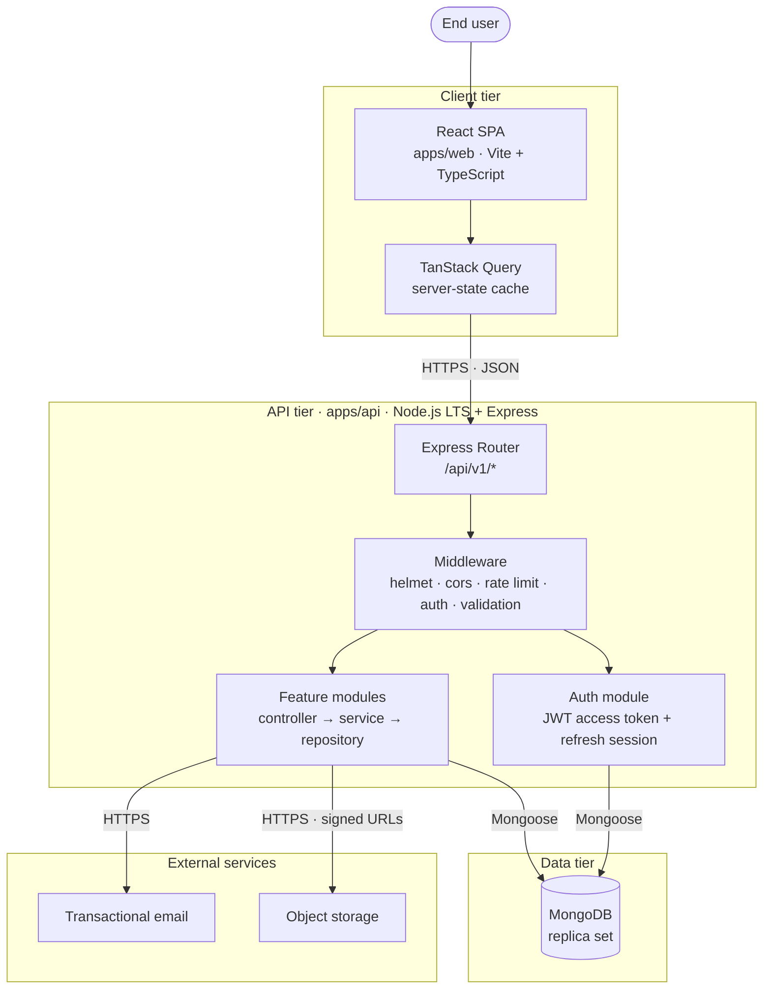
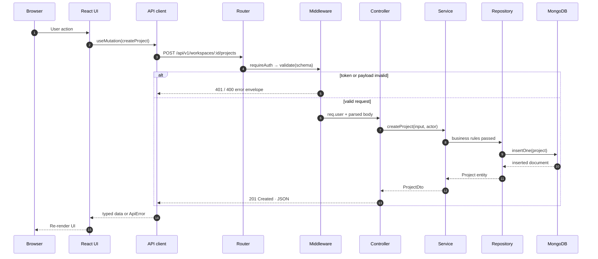
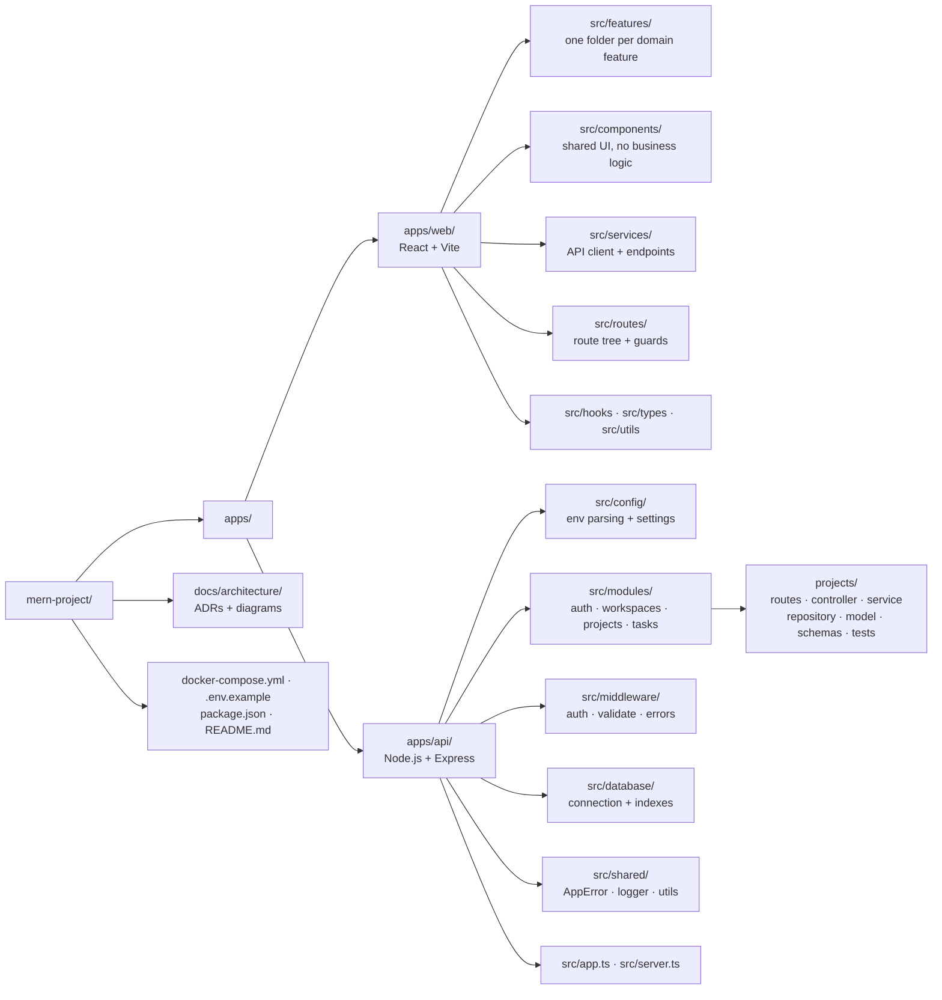
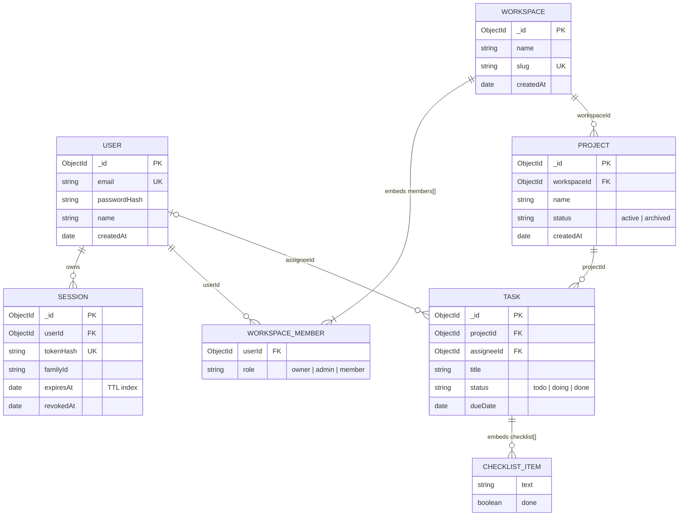
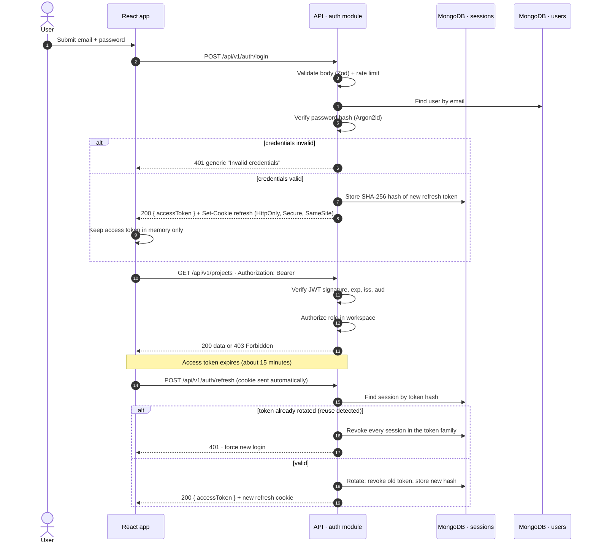
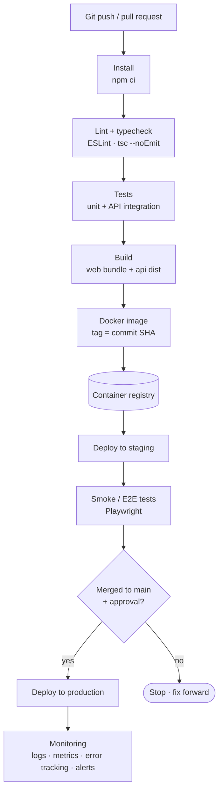
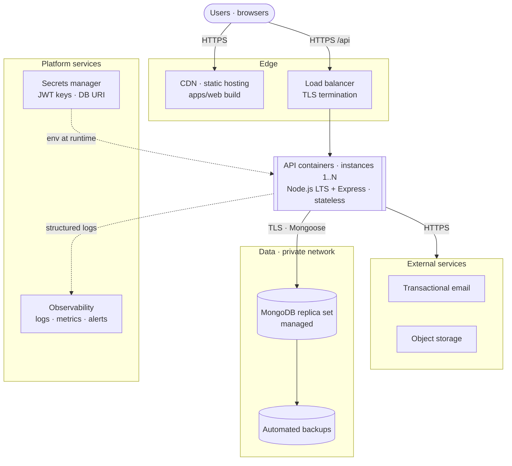

# How to Start a MERN Stack Project: Architecture, Structure & Best Practices

> Published by [Brick & Mortar](https://brick-mortar.com.mx/en) · [Read it on the web](https://brick-mortar.com.mx/en/blog/mern-stack-project)

**A practical guide to building scalable full-stack applications with MongoDB, Express, React and Node.js.**

Most MERN tutorials end when the first request reaches the database. Real projects start there. The decisions you make in the first week — folder structure, where business rules live, how errors travel, how users authenticate, how code reaches production — decide whether the codebase is still pleasant to work on a year later.

This guide is the first part of the **Brick & Mortar MERN Engineering Series**. Instead of a toy app, it walks through the architecture we would propose to a client starting a real product: a multi-tenant project tracker where users belong to *workspaces*, workspaces contain *projects* and projects contain *tasks*. Every code sample was type-checked with TypeScript 7 and the API tests were run against a real MongoDB before publishing.

> Reference README with every diagram and AI agent instructions: [README.md](./README.md)

## Introduction: what is the MERN stack?

MERN is a JavaScript/TypeScript stack made of four pieces:

| Piece | Role | In this guide |
| --- | --- | --- |
| **MongoDB** | Document database | MongoDB 8, accessed with Mongoose 9 |
| **Express** | HTTP framework for Node.js | Express 5 |
| **React** | UI library for the browser | React 19 with Vite 8 |
| **Node.js** | JavaScript runtime on the server | Node.js 26 LTS |

Its main advantage is not speed or popularity. It is **one language and one type system end to end**. A validation rule, a TypeScript type or a date helper means the same thing in the browser and on the server, and engineers move across the stack without switching mental models.

MERN fits well when your data is document-shaped (nested, evolving, tenant-scoped), when you want a JSON API consumed by one or more clients, and when your team is strong in TypeScript. It is a weaker fit for workloads dominated by complex relational reporting across many entities — there a relational database often serves you better.

## Understanding the MERN architecture

A MERN application has three tiers: a React single-page app in the browser, a stateless Express API, and MongoDB. External services (email, file storage, payments) are called **only from the API**, never directly from the browser with secret keys.



*High-level architecture of the reference project.*

Inside the API, every request follows the same path. Each layer has one job, which is what makes the code testable and easy to change:



*Request lifecycle: Browser → React → API client → Router → Middleware → Controller → Service → Repository → MongoDB.*

| Layer | Responsibility | Must not |
| --- | --- | --- |
| Router | Map method + path to middleware and a handler | Contain logic |
| Middleware | Cross-cutting concerns: auth, validation, rate limiting, logging | Know about a specific feature |
| Controller | Translate HTTP into a service call and pick the status code | Touch the database or apply business rules |
| Service | Business rules, authorization, orchestration | Import Express or read `req`/`res` |
| Repository | Persistence through Mongoose | Apply business rules or throw HTTP errors |

The rule that matters most: **business logic lives in services, not in controllers**. A controller that queries MongoDB and decides who may do what is the most common reason MERN codebases become hard to test.

## Planning your application before coding

An hour of planning removes weeks of rework. Before `npm init`, write down — in a short document inside `docs/architecture/` — the answers to these questions:

1. **Users and tenancy.** Who uses the system? Do users belong to organizations (workspaces, teams, stores)? Multi-tenancy changes every query, so decide it on day one.
2. **Core entities and their lifecycles.** For our example: user, workspace, project, task. What states does each go through (a project can be `active` or `archived`)?
3. **Access rules.** Who can create, read, update and delete each entity? Write them as a table; they become your service-level authorization tests.
4. **Read patterns.** Which screens exist and what do they query? MongoDB schemas are designed around how data is read, not just how it is shaped.
5. **Non-functional requirements.** Expected users, data volume, availability target, compliance (personal data, retention), and the budget for infrastructure.
6. **Integrations.** Email, payments, file storage, analytics. Each one is a module boundary and a secret to manage.

Record significant decisions as **Architecture Decision Records** (ADRs): one short Markdown file per decision with context, decision and consequences. They are cheap to write and invaluable when someone — human or AI agent — asks "why is it like this?" six months later.

## Choosing the right project structure

For most teams starting a product, we recommend a **monorepo with npm workspaces**: one repository, two applications.



*Monorepo layout. Each API module (e.g. projects) contains routes, controller, service, repository, model, schemas and tests.*

```text
mern-project/
├── apps/
│   ├── web/
│   │   ├── src/
│   │   │   ├── components/   # shared, presentational UI — no business logic
│   │   │   ├── features/     # one folder per domain feature: projects/, tasks/
│   │   │   ├── hooks/        # cross-feature hooks
│   │   │   ├── services/     # API client
│   │   │   ├── routes/       # route tree and guards
│   │   │   ├── types/
│   │   │   └── utils/
│   │   └── package.json
│   └── api/
│       ├── src/
│       │   ├── config/       # environment parsing
│       │   ├── modules/      # auth/, workspaces/, projects/, tasks/
│       │   ├── middleware/   # validate, requireAuth, errorHandler
│       │   ├── database/     # connection lifecycle
│       │   ├── shared/       # AppError, logger
│       │   ├── app.ts        # Express app factory (composition root)
│       │   └── server.ts     # process entry point
│       └── package.json
├── docs/
│   └── architecture/         # ADRs + diagrams
├── docker-compose.yml
├── .env.example
├── package.json              # workspaces root
└── README.md
```

What each part is for:

- **`apps/web/src/features/`** is where most frontend code lives. A feature folder owns its API calls, hooks and components. Code moves to `components/` or `hooks/` only when a second feature needs it.
- **`apps/api/src/modules/`** groups the backend **by feature, not by technical type**. Everything about projects — routes, controller, service, repository, model, schemas, tests — sits in `modules/projects/`. Deleting or extracting a feature means touching one folder.
- **`config/`, `middleware/`, `database/`, `shared/`** hold cross-cutting code that every module uses.
- **`app.ts`** builds the Express app and is the only place that wires concrete implementations together. **`server.ts`** connects to the database and starts listening. Keeping them separate lets tests import the app without opening a port.

**When to use this structure:** one product, one or two teams, a web client and an API that change together. **When not to:** if several independent teams deploy on different schedules, or the API serves many unrelated clients, separate repositories (or a larger monorepo with build tooling such as Nx or Turborepo) may be worth the extra setup. Add a `packages/shared` workspace only when you really share code, such as Zod schemas used by both apps.

## Setting up the development environment

You need three things installed: **Node.js 26 LTS** (or 24 LTS), **npm**, and **Docker** for running MongoDB locally. Pin the Node version so every machine and the CI use the same one:

```bash
mkdir mern-project && cd mern-project
echo "26" > .nvmrc
nvm use                      # or: fnm use
npm init -y
```

Turn the root into a workspaces root:

`package.json`

```json
{
  "name": "mern-project",
  "private": true,
  "type": "module",
  "workspaces": ["apps/*"],
  "engines": { "node": ">=24" },
  "scripts": {
    "dev:api": "npm run dev -w apps/api",
    "dev:web": "npm run dev -w apps/web",
    "lint": "eslint .",
    "build": "npm run build --workspaces --if-present",
    "typecheck": "npm run typecheck --workspaces --if-present",
    "test": "npm run test --workspaces --if-present"
  }
}
```

Then scaffold the two apps:

```bash
# Frontend: Vite's official React + TypeScript template
npm create vite@latest apps/web -- --template react-ts

# Backend
mkdir -p apps/api/src && cd apps/api && npm init -y && cd ../..
npm install -w apps/api express mongoose zod jose argon2 cookie-parser helmet cors express-rate-limit pino pino-http
npm install -w apps/api -D typescript tsx @types/express @types/cookie-parser @types/cors @types/node vitest supertest @types/supertest mongodb-memory-server
```

The frontend dependencies come next, plus linting at the root:

```bash
npm install -w apps/web @tanstack/react-query
npm install -D eslint @eslint/js typescript-eslint
```

ESLint also enforces the architecture. This flat config fails the build if a service imports Express, if a controller imports Mongoose, or if the web app imports API code:

`eslint.config.js`

```js
import js from "@eslint/js";
import { defineConfig } from "eslint/config";
import tseslint from "typescript-eslint";

export default defineConfig(
  { ignores: ["**/dist/**", "**/node_modules/**"] },
  js.configs.recommended,
  tseslint.configs.recommended,
  {
    rules: {
      // Express identifies error handlers by their 4 parameters, so `_next` must stay.
      "@typescript-eslint/no-unused-vars": ["error", { argsIgnorePattern: "^_" }],
    },
  },
  {
    // Layer rules: business logic must not depend on HTTP, controllers must not touch the database.
    files: ["apps/api/src/**/*.service.ts", "apps/api/src/**/*.repository.ts"],
    rules: {
      "no-restricted-imports": ["error", { paths: [{ name: "express", message: "Services and repositories must not depend on Express." }] }],
    },
  },
  {
    files: ["apps/api/src/**/*.controller.ts", "apps/api/src/**/*.routes.ts"],
    rules: {
      "no-restricted-imports": ["error", { paths: [{ name: "mongoose", message: "Controllers and routes must not access the database. Call a service." }] }],
    },
  },
  {
    // The web app must never import server code.
    files: ["apps/web/src/**/*.{ts,tsx}"],
    rules: {
      "no-restricted-imports": ["error", { patterns: [{ group: ["**/apps/api/**", "@mern-project/api"], message: "The web app must not import API code." }] }],
    },
  },
);
```

Notice what is **not** here: no Redux, no Axios, no Moment, no nodemon, no dotenv. Node.js has `fetch`, `--watch` and `--env-file` built in; TanStack Query handles server state; `tsx` runs TypeScript in development. Every dependency is code you will have to update and audit, so each one has to earn its place.

## Creating the backend with Node.js and Express

The API package uses ES modules and TypeScript with Node's module resolution (dependencies omitted for brevity):

`apps/api/package.json`

```json
{
  "name": "@mern-project/api",
  "private": true,
  "type": "module",
  "scripts": {
    "dev": "tsx watch --env-file=.env src/server.ts",
    "build": "tsc -p tsconfig.build.json",
    "start": "node dist/server.js",
    "typecheck": "tsc --noEmit",
    "test": "vitest run"
  }
}
```

`apps/api/tsconfig.json`

```json
{
  "compilerOptions": {
    "target": "es2023",
    "module": "nodenext",
    "moduleResolution": "nodenext",
    "strict": true,
    "noUncheckedIndexedAccess": true,
    "esModuleInterop": true,
    "skipLibCheck": true,
    "types": ["node"],
    "outDir": "dist",
    "rootDir": "src",
    "sourceMap": true
  },
  "include": ["src"]
}
```

With `module: "nodenext"`, relative imports include the `.js` extension (`import { AppError } from "./shared/errors.js"`) even though the source files are `.ts`. That is how Node resolves ES modules after compilation.

### Fail fast on configuration

The first file to write is the one that reads configuration. If something is missing, the process should refuse to start with a clear message rather than fail at 3 a.m. on the first request that needs it:

`apps/api/src/config/env.ts`

```ts
import { z } from "zod";

const EnvSchema = z.object({
  NODE_ENV: z.enum(["development", "test", "production"]).default("development"),
  PORT: z.coerce.number().int().positive().default(4000),
  MONGODB_URI: z.url(),
  CORS_ORIGIN: z.url(),
  JWT_ACCESS_SECRET: z.string().min(32, "Use at least 32 random characters"),
  JWT_ISSUER: z.string().default("mern-project-api"),
  JWT_AUDIENCE: z.string().default("mern-project-web"),
  ACCESS_TOKEN_TTL: z.string().default("15m"),
  REFRESH_TOKEN_TTL_DAYS: z.coerce.number().int().positive().default(14),
});

export type Env = z.infer<typeof EnvSchema>;

// Fail fast at boot: a missing or malformed variable stops the process with a clear message.
export function loadEnv(source: NodeJS.ProcessEnv = process.env): Env {
  const result = EnvSchema.safeParse(source);
  if (!result.success) {
    console.error("Invalid environment configuration:\n" + z.prettifyError(result.error));
    process.exit(1);
  }
  return result.data;
}
```

### One error type, one error format

Expected failures — not found, forbidden, invalid input — are modeled as an `AppError` with an HTTP status and a stable machine-readable `code`. Clients switch on `code`, never on the message text:

`apps/api/src/shared/errors.ts`

```ts
export type ErrorCode =
  | "VALIDATION_ERROR"
  | "UNAUTHORIZED"
  | "FORBIDDEN"
  | "NOT_FOUND"
  | "CONFLICT"
  | "INTERNAL_ERROR";

/** Expected, client-facing failures. Anything else is treated as a 500. */
export class AppError extends Error {
  constructor(
    public readonly status: number,
    public readonly code: ErrorCode,
    message: string,
    public readonly details?: unknown,
  ) {
    super(message);
    this.name = "AppError";
  }

  static badRequest(message: string, details?: unknown) {
    return new AppError(400, "VALIDATION_ERROR", message, details);
  }
  static unauthorized(message = "Authentication required") {
    return new AppError(401, "UNAUTHORIZED", message);
  }
  static forbidden(message = "You do not have access to this resource") {
    return new AppError(403, "FORBIDDEN", message);
  }
  static notFound(resource: string) {
    return new AppError(404, "NOT_FOUND", `${resource} not found`);
  }
  static conflict(message: string) {
    return new AppError(409, "CONFLICT", message);
  }
}

/** Shape of every error response the API sends. */
export type ErrorEnvelope = { error: { code: ErrorCode; message: string; details?: unknown; requestId?: string } };
```

### The app factory

`createApp` assembles middleware, wires modules and registers the error handler last. It is also the **composition root**: the only place that instantiates concrete classes. Everything else receives its dependencies through constructors.

`apps/api/src/app.ts`

```ts
import cookieParser from "cookie-parser";
import cors from "cors";
import express, { type Express } from "express";
import { rateLimit } from "express-rate-limit";
import helmet from "helmet";
import { pinoHttp } from "pino-http";
import type { Env } from "./config/env.js";
import { errorHandler, notFoundHandler } from "./middleware/error-handler.js";
import { requireAuth } from "./middleware/require-auth.js";
import { ProjectController } from "./modules/projects/project.controller.js";
import { MongoProjectRepository } from "./modules/projects/project.repository.js";
import { projectRoutes } from "./modules/projects/project.routes.js";
import { ProjectService } from "./modules/projects/project.service.js";
import { MongoWorkspaceAccess } from "./modules/workspaces/workspace-access.js";
import { logger } from "./shared/logger.js";

/** Composition root: the only place that knows concrete implementations. */
export function createApp(env: Env): Express {
  const app = express();
  app.set("trust proxy", 1); // behind one load balancer: needed for secure cookies and rate limiting

  app.use(pinoHttp({ logger }));
  app.use(helmet());
  app.use(cors({ origin: env.CORS_ORIGIN, credentials: true }));
  app.use(express.json({ limit: "100kb" }));
  app.use(cookieParser());
  app.use("/api/v1/auth", rateLimit({ windowMs: 15 * 60 * 1000, limit: 20 }));

  app.get("/health", (_req, res) => {
    res.json({ status: "ok" });
  });

  const projects = new ProjectController(new ProjectService(new MongoProjectRepository(), new MongoWorkspaceAccess()));
  app.use("/api/v1/workspaces/:workspaceId/projects", projectRoutes(projects, requireAuth(env)));

  app.use(notFoundHandler);
  app.use(errorHandler);
  return app;
}
```

`server.ts` connects to MongoDB, starts listening and shuts down gracefully when the platform sends `SIGTERM` during a deploy:

`apps/api/src/server.ts`

```ts
import { loadEnv } from "./config/env.js";
import { connectDatabase, disconnectDatabase } from "./database/connection.js";
import { createApp } from "./app.js";
import { logger } from "./shared/logger.js";

const env = loadEnv();
await connectDatabase(env.MONGODB_URI);

const server = createApp(env).listen(env.PORT, () => {
  logger.info(`API listening on port ${env.PORT}`);
});

// Graceful shutdown: stop accepting connections, finish in-flight requests, close the pool.
for (const signal of ["SIGTERM", "SIGINT"] as const) {
  process.on(signal, () => {
    logger.info(`${signal} received, shutting down`);
    server.close(async () => {
      await disconnectDatabase();
      process.exit(0);
    });
  });
}
```

### A feature module: projects

Here is the complete `projects` module. Read it top-down, from the outside of the system to the database.

**Routes** declare the path, the middleware order and the handler. Nothing else:

`apps/api/src/modules/projects/project.routes.ts`

```ts
import { Router, type RequestHandler } from "express";
import { validate } from "../../middleware/validate.js";
import type { ProjectController } from "./project.controller.js";
import { CreateProjectBody, ListProjectsQuery, WorkspaceParams } from "./project.schemas.js";

export function projectRoutes(controller: ProjectController, auth: RequestHandler): Router {
  // mergeParams exposes :workspaceId from the parent router.
  const router = Router({ mergeParams: true });
  router.use(auth);
  router.get("/", validate({ params: WorkspaceParams, query: ListProjectsQuery }), controller.list);
  router.post("/", validate({ params: WorkspaceParams, body: CreateProjectBody }), controller.create);
  return router;
}
```

**Controller** reads already-validated input, calls one service method and picks the status code:

`apps/api/src/modules/projects/project.controller.ts`

```ts
import type { Request, Response } from "express";
import type { ProjectService } from "./project.service.js";
import type { CreateProjectInput, ListProjectsQuery, ProjectDto, WorkspaceParams } from "./project.schemas.js";

/** Translates HTTP <-> service calls. No business rules, no database access. */
export class ProjectController {
  constructor(private readonly service: ProjectService) {}

  create = async (req: Request<WorkspaceParams, ProjectDto, CreateProjectInput>, res: Response<ProjectDto>) => {
    const project = await this.service.create(req.params.workspaceId, req.body, req.user!);
    res.status(201).json(project);
  };

  list = async (req: Request<WorkspaceParams, { data: ProjectDto[] }, unknown, ListProjectsQuery>, res: Response<{ data: ProjectDto[] }>) => {
    const data = await this.service.list(req.params.workspaceId, req.query, req.user!);
    res.json({ data });
  };
}
```

**Service** holds the business rules. It depends on two interfaces — `ProjectRepository` and `WorkspaceAccess` — not on Mongoose or Express, which is the dependency inversion principle applied where it pays off: services can be unit-tested with in-memory fakes.

`apps/api/src/modules/projects/project.service.ts`

```ts
import { AppError } from "../../shared/errors.js";
import type { AuthUser } from "../../middleware/require-auth.js";
import type { WorkspaceAccess } from "../workspaces/workspace-access.js";
import type { ProjectDocument } from "./project.model.js";
import type { ProjectRepository } from "./project.repository.js";
import type { CreateProjectInput, ListProjectsQuery, ProjectDto } from "./project.schemas.js";

/** Business rules live here: no Express, no HTTP, easy to unit test with fakes. */
export class ProjectService {
  constructor(
    private readonly projects: ProjectRepository,
    private readonly access: WorkspaceAccess,
  ) {}

  async create(workspaceId: string, input: CreateProjectInput, actor: AuthUser): Promise<ProjectDto> {
    const role = await this.access.getRole(workspaceId, actor.id);
    if (!role) throw AppError.notFound("Workspace"); // do not reveal that the workspace exists
    if (role === "member") throw AppError.forbidden("Only owners and admins can create projects");

    const project = await this.projects.create({ ...input, workspaceId, createdBy: actor.id });
    return toProjectDto(project);
  }

  async list(workspaceId: string, query: ListProjectsQuery, actor: AuthUser): Promise<ProjectDto[]> {
    const role = await this.access.getRole(workspaceId, actor.id);
    if (!role) throw AppError.notFound("Workspace");
    const projects = await this.projects.listByWorkspace(workspaceId, query);
    return projects.map(toProjectDto);
  }
}

export function toProjectDto(p: ProjectDocument): ProjectDto {
  return {
    id: p._id.toString(),
    workspaceId: p.workspaceId.toString(),
    name: p.name,
    description: p.description ?? null,
    status: p.status,
    createdAt: p.createdAt.toISOString(),
  };
}
```

Notice two decisions in `create`: a user who is not a member gets **404, not 403**, so the API does not reveal which workspace ids exist; and the service returns a **DTO**, never a Mongoose document, so internal fields cannot leak into responses by accident.

## Connecting MongoDB and designing data models

Connection handling lives in one small file:

`apps/api/src/database/connection.ts`

```ts
import mongoose from "mongoose";
import { logger } from "../shared/logger.js";

export async function connectDatabase(uri: string): Promise<void> {
  mongoose.set("strictQuery", true);
  mongoose.connection.on("disconnected", () => logger.warn("MongoDB disconnected"));
  await mongoose.connect(uri, { serverSelectionTimeoutMS: 10_000 });
  logger.info("MongoDB connected");
}

export async function disconnectDatabase(): Promise<void> {
  await mongoose.disconnect();
}
```

Run MongoDB as a **replica set** even locally (the Docker setup below does this with a single node). Multi-document transactions and change streams require it, and you do not want to discover that difference in production.

### Embed or reference?

The central MongoDB modeling question is whether related data is embedded in a document or stored in its own collection and referenced by id. A practical rule:

- **Embed** when the data is bounded, owned by the parent and almost always read with it.
- **Reference** when the data grows without limit, is queried on its own or is shared.



*Data model: members and checklist items are embedded; projects, tasks and sessions are referenced.*

| Relationship | Strategy | Why |
| --- | --- | --- |
| Workspace → members | Embedded array | Small, bounded, read on every authorization check |
| Workspace → projects | Reference (`workspaceId`) | Unbounded, listed and paginated on their own |
| Project → tasks | Reference (`projectId`) | Unbounded, filtered by status and assignee |
| Task → checklist | Embedded array | A handful of items edited together with the task |
| User → sessions | Reference + TTL index | Expire automatically, revoked per token family |

The workspace model embeds members and exposes a small `WorkspaceAccess` interface that other modules use to check roles, instead of importing the workspace model directly:

`apps/api/src/modules/workspaces/workspace-access.ts`

```ts
import { Schema, model } from "mongoose";

export type WorkspaceRole = "owner" | "admin" | "member";

const workspaceSchema = new Schema(
  {
    name: { type: String, required: true, trim: true },
    slug: { type: String, required: true, unique: true, lowercase: true },
    // Bounded, always read with the workspace: a good fit for embedding.
    members: [
      {
        _id: false,
        userId: { type: Schema.Types.ObjectId, ref: "User", required: true },
        role: { type: String, enum: ["owner", "admin", "member"], required: true },
      },
    ],
  },
  { timestamps: true },
);
workspaceSchema.index({ "members.userId": 1 });

export const WorkspaceModel = model("Workspace", workspaceSchema);

export interface WorkspaceAccess {
  getRole(workspaceId: string, userId: string): Promise<WorkspaceRole | null>;
}

export class MongoWorkspaceAccess implements WorkspaceAccess {
  async getRole(workspaceId: string, userId: string): Promise<WorkspaceRole | null> {
    const workspace = await WorkspaceModel.findOne(
      { _id: workspaceId, "members.userId": userId },
      { "members.$": 1 },
    ).lean();
    return (workspace?.members[0]?.role as WorkspaceRole | undefined) ?? null;
  }
}
```

The project model declares **indexes that match the queries** the service runs. An index you do not query is a write cost with no benefit; a query without an index is a full collection scan that works fine in development and collapses with real data.

`apps/api/src/modules/projects/project.model.ts`

```ts
import { Schema, model, type InferSchemaType, type Types } from "mongoose";

const projectSchema = new Schema(
  {
    workspaceId: { type: Schema.Types.ObjectId, ref: "Workspace", required: true },
    name: { type: String, required: true, trim: true, maxlength: 120 },
    description: { type: String, trim: true, maxlength: 2000 },
    status: { type: String, enum: ["active", "archived"], default: "active", required: true },
    createdBy: { type: Schema.Types.ObjectId, ref: "User", required: true },
  },
  { timestamps: true },
);

// Supports the most common query: "active projects of a workspace, newest first".
projectSchema.index({ workspaceId: 1, status: 1, createdAt: -1 });
// Project names are unique inside a workspace, not globally.
projectSchema.index({ workspaceId: 1, name: 1 }, { unique: true });

export type ProjectDocument = InferSchemaType<typeof projectSchema> & { _id: Types.ObjectId };
export const ProjectModel = model("Project", projectSchema);
```

The repository is the only code that talks to Mongoose. It returns plain objects (`lean()` / `toObject()`), never live documents:

`apps/api/src/modules/projects/project.repository.ts`

```ts
import { ProjectModel, type ProjectDocument } from "./project.model.js";

export type NewProject = { workspaceId: string; name: string; description?: string; createdBy: string };

/** Persistence contract. Services depend on this interface, not on Mongoose. */
export interface ProjectRepository {
  create(data: NewProject): Promise<ProjectDocument>;
  listByWorkspace(workspaceId: string, opts: { status: "active" | "archived"; limit: number }): Promise<ProjectDocument[]>;
}

export class MongoProjectRepository implements ProjectRepository {
  async create(data: NewProject): Promise<ProjectDocument> {
    const doc = await ProjectModel.create(data);
    return doc.toObject();
  }

  async listByWorkspace(workspaceId: string, opts: { status: "active" | "archived"; limit: number }) {
    return ProjectModel.find({ workspaceId, status: opts.status })
      .sort({ createdAt: -1 })
      .limit(opts.limit)
      .lean<ProjectDocument[]>()
      .exec();
  }
}
```

## Building the frontend with React and TypeScript

The frontend is a Vite single-page app. Two choices shape it more than any component library:

1. **Organize by feature.** `src/features/projects/` owns the projects API calls, hooks and components. Shared UI goes to `src/components/` only when a second feature needs it.
2. **Separate server state from UI state.** Data that lives on the server — projects, tasks, the current user — is a *cache* of the backend, and TanStack Query manages it: caching, deduplication, background refetching, retries and invalidation. Local UI state (an open modal, a form draft) stays in React state. Most apps that add a global store for server data end up re-implementing a worse cache.

Typed API functions for the feature:

`apps/web/src/features/projects/projects.api.ts`

```ts
import { apiRequest } from "../../services/api-client";

export type Project = {
  id: string;
  workspaceId: string;
  name: string;
  description: string | null;
  status: "active" | "archived";
  createdAt: string;
};

export type CreateProjectInput = { name: string; description?: string };

export const projectsApi = {
  list: (workspaceId: string, status: Project["status"] = "active") =>
    apiRequest<{ data: Project[] }>(`/workspaces/${workspaceId}/projects?status=${status}`).then((r) => r.data),
  create: (workspaceId: string, input: CreateProjectInput) =>
    apiRequest<Project>(`/workspaces/${workspaceId}/projects`, { method: "POST", body: JSON.stringify(input) }),
};
```

Hooks wrap them with TanStack Query. Query keys are defined in **one** place so invalidation never drifts out of sync with the queries:

`apps/web/src/features/projects/use-projects.ts`

```ts
import { useMutation, useQuery, useQueryClient } from "@tanstack/react-query";
import { projectsApi, type CreateProjectInput } from "./projects.api";

// One place defines cache keys, so invalidation can never drift out of sync.
export const projectKeys = {
  all: (workspaceId: string) => ["workspaces", workspaceId, "projects"] as const,
};

export function useProjects(workspaceId: string) {
  return useQuery({
    queryKey: projectKeys.all(workspaceId),
    queryFn: () => projectsApi.list(workspaceId),
    staleTime: 30_000,
  });
}

export function useCreateProject(workspaceId: string) {
  const queryClient = useQueryClient();
  return useMutation({
    mutationFn: (input: CreateProjectInput) => projectsApi.create(workspaceId, input),
    onSuccess: () => queryClient.invalidateQueries({ queryKey: projectKeys.all(workspaceId) }),
  });
}
```

Components then stay small and declarative, and handle loading, error and empty states explicitly:

`apps/web/src/features/projects/ProjectList.tsx`

```tsx
import { ApiError } from "../../services/api-client";
import { useProjects } from "./use-projects";

export function ProjectList({ workspaceId }: { workspaceId: string }) {
  const { data: projects, isPending, error } = useProjects(workspaceId);

  if (isPending) return <p aria-busy="true">Loading projects…</p>;
  if (error) {
    const message = error instanceof ApiError && error.status === 403 ? "You do not have access to this workspace." : "Could not load projects.";
    return <p role="alert">{message}</p>;
  }
  if (projects.length === 0) return <p>No projects yet.</p>;

  return (
    <ul>
      {projects.map((project) => (
        <li key={project.id}>{project.name}</li>
      ))}
    </ul>
  );
}
```

## Connecting frontend and backend

All HTTP traffic goes through a single API client. It attaches the access token, sends cookies, refreshes the token once when it expires and turns the API's error envelope into a typed `ApiError`:

`apps/web/src/services/api-client.ts`

```ts
const API_URL = import.meta.env.VITE_API_URL; // e.g. https://api.example.com/api/v1

export type ApiErrorBody = { error: { code: string; message: string; details?: unknown; requestId?: string } };

export class ApiError extends Error {
  constructor(
    public readonly status: number,
    public readonly body: ApiErrorBody["error"],
  ) {
    super(body.message);
    this.name = "ApiError";
  }
}

// The access token lives in memory only. The refresh token is an HttpOnly cookie the browser sends for us.
let accessToken: string | null = null;
export const setAccessToken = (token: string | null) => {
  accessToken = token;
};

let refreshing: Promise<boolean> | null = null;
function refreshAccessToken(): Promise<boolean> {
  // Deduplicate: many requests failing at once trigger a single refresh call.
  refreshing ??= fetch(`${API_URL}/auth/refresh`, { method: "POST", credentials: "include" })
    .then(async (res) => {
      if (!res.ok) return false;
      setAccessToken(((await res.json()) as { accessToken: string }).accessToken);
      return true;
    })
    .catch(() => false)
    .finally(() => {
      refreshing = null;
    });
  return refreshing;
}

export async function apiRequest<T>(path: string, init: RequestInit = {}, retry = true): Promise<T> {
  const headers = new Headers(init.headers);
  if (init.body !== undefined) headers.set("Content-Type", "application/json");
  if (accessToken) headers.set("Authorization", `Bearer ${accessToken}`);

  const res = await fetch(`${API_URL}${path}`, { ...init, headers, credentials: "include" });

  if (res.status === 401 && retry && (await refreshAccessToken())) {
    return apiRequest<T>(path, init, false);
  }
  if (!res.ok) {
    const body = (await res.json().catch(() => null)) as ApiErrorBody | null;
    throw new ApiError(res.status, body?.error ?? { code: "UNKNOWN", message: res.statusText });
  }
  return (res.status === 204 ? undefined : await res.json()) as T;
}
```

Three details matter here:

- **`credentials: "include"`** sends the refresh cookie on cross-origin requests. The API must answer with `Access-Control-Allow-Credentials` and an exact origin — which is why `CORS_ORIGIN` is a single URL, never `*`.
- **Concurrent refreshes are deduplicated.** When five requests fail at once because the token expired, only one refresh call is made.
- **`VITE_API_URL` is public.** Anything prefixed with `VITE_` ends up in the JavaScript bundle. Never put secrets in frontend environment variables.

In development, run the web app on `localhost:5173` and the API on `localhost:4000`. In production, serving the API under the same site (for example `app.example.com` and `api.example.com`, or a `/api` path behind the same domain) keeps `SameSite` cookies simple.

## Authentication and security best practices

There are two sound options for a MERN app:

| Option | Use it when | Trade-off |
| --- | --- | --- |
| **Server-side sessions** (session id in an HttpOnly cookie, session data in MongoDB or Redis) | One web app on the same site | Simplest and easy to revoke; needs a shared session store when you scale out |
| **Access JWT + rotating refresh token** | Several clients, or an API you want stateless per request | More moving parts; requires rotation and revocation to be secure |

This guide implements the second option because it is the one teams most often get wrong:



*Login, authorization and refresh-token rotation with reuse detection.*

The token helpers:

`apps/api/src/modules/auth/tokens.ts`

```ts
import { createHash, randomBytes } from "node:crypto";
import type { CookieOptions } from "express";
import { SignJWT } from "jose";
import type { Env } from "../../config/env.js";

export function signAccessToken(env: Env, user: { id: string; email: string }): Promise<string> {
  return new SignJWT({ email: user.email })
    .setProtectedHeader({ alg: "HS256" })
    .setSubject(user.id)
    .setIssuer(env.JWT_ISSUER)
    .setAudience(env.JWT_AUDIENCE)
    .setIssuedAt()
    .setExpirationTime(env.ACCESS_TOKEN_TTL)
    .sign(new TextEncoder().encode(env.JWT_ACCESS_SECRET));
}

/** Refresh tokens are opaque random strings. Only their SHA-256 hash is stored. */
export function createRefreshToken(): { token: string; tokenHash: string } {
  const token = randomBytes(32).toString("base64url");
  return { token, tokenHash: hashToken(token) };
}

export function hashToken(token: string): string {
  return createHash("sha256").update(token).digest("hex");
}

export function refreshCookieOptions(env: Env): CookieOptions {
  return {
    httpOnly: true, // not readable from JavaScript
    secure: env.NODE_ENV === "production",
    sameSite: "strict",
    path: "/api/v1/auth", // only sent to the auth endpoints
    maxAge: env.REFRESH_TOKEN_TTL_DAYS * 24 * 60 * 60 * 1000,
  };
}
```

And the middleware that protects routes:

`apps/api/src/middleware/require-auth.ts`

```ts
import type { RequestHandler } from "express";
import { jwtVerify } from "jose";
import type { Env } from "../config/env.js";
import { AppError } from "../shared/errors.js";

export type AuthUser = { id: string; email: string };

declare global {
  // eslint-disable-next-line @typescript-eslint/no-namespace
  namespace Express {
    interface Request {
      user?: AuthUser;
    }
  }
}

export function requireAuth(env: Env): RequestHandler {
  const secret = new TextEncoder().encode(env.JWT_ACCESS_SECRET);
  return async (req, _res, next) => {
    const header = req.get("authorization");
    if (!header?.startsWith("Bearer ")) throw AppError.unauthorized();
    try {
      const { payload } = await jwtVerify(header.slice("Bearer ".length), secret, {
        issuer: env.JWT_ISSUER,
        audience: env.JWT_AUDIENCE,
        algorithms: ["HS256"],
      });
      if (typeof payload.sub !== "string" || typeof payload.email !== "string") throw new Error("Malformed claims");
      req.user = { id: payload.sub, email: payload.email };
      next();
    } catch {
      throw AppError.unauthorized("Invalid or expired token");
    }
  };
}
```

The rules behind the diagram:

- **Hash passwords with Argon2id** (the `argon2` package), as recommended by the OWASP Password Storage Cheat Sheet. Never log or return a hash.
- **Access tokens are short-lived** (about 15 minutes) and kept **in memory** on the client — not in `localStorage`, where any injected script can read them.
- **Refresh tokens are opaque random strings** in an `HttpOnly`, `Secure`, `SameSite=Strict` cookie scoped to `/api/v1/auth`. The database stores only their SHA-256 hash.
- **Rotate refresh tokens on every use** and detect reuse: if an already-rotated token comes back, assume it was stolen and revoke every session in that token family. This follows the OAuth 2.0 Security Best Current Practice (RFC 9700).
- **Verify everything in the JWT**: signature, algorithm, expiry, issuer and audience.
- **Authorize in the service**, against the user's role in the workspace. Hiding a button in the UI is not access control.
- **Defense in depth:** `helmet` for security headers, a strict CORS allow-list, rate limiting on auth endpoints, a JSON body size limit, and Zod schemas that strip unknown keys (which prevents mass-assignment of fields like `role`).

## Error handling and validation

Validation happens **at the edge**, before a controller runs. One middleware parses params, query and body with Zod and replaces them with typed, trusted values:

`apps/api/src/middleware/validate.ts`

```ts
import type { RequestHandler } from "express";
import { z } from "zod";
import { AppError } from "../shared/errors.js";

type Schemas<P extends z.ZodType, B extends z.ZodType, Q extends z.ZodType> = { params?: P; body?: B; query?: Q };

/**
 * Parses params/body/query with Zod at the edge. Handlers downstream receive typed, trusted input.
 * Unknown keys are stripped by z.object(), so mass-assignment of extra fields is not possible.
 */
export function validate<P extends z.ZodType = z.ZodUnknown, B extends z.ZodType = z.ZodUnknown, Q extends z.ZodType = z.ZodUnknown>(
  schemas: Schemas<P, B, Q>,
): RequestHandler<z.infer<P>, unknown, z.infer<B>, z.infer<Q>> {
  return (req, _res, next) => {
    const issues: Record<string, unknown> = {};
    for (const key of ["params", "body", "query"] as const) {
      const schema: z.ZodType | undefined = schemas[key];
      if (!schema) continue;
      const result = schema.safeParse(req[key]);
      if (!result.success) {
        issues[key] = z.treeifyError(result.error);
        continue;
      }
      // Express 5 exposes req.query as a getter, so redefine it instead of assigning.
      Object.defineProperty(req, key, { value: result.data, writable: true, enumerable: true, configurable: true });
    }
    if (Object.keys(issues).length > 0) return next(AppError.badRequest("Invalid request", issues));
    next();
  };
}
```

The schemas double as TypeScript types, so the contract is written once:

`apps/api/src/modules/projects/project.schemas.ts`

```ts
import { isValidObjectId } from "mongoose";
import { z } from "zod";

export const objectId = z.string().refine(isValidObjectId, "Invalid id");

export const WorkspaceParams = z.object({ workspaceId: objectId });

export const CreateProjectBody = z.object({
  name: z.string().trim().min(2).max(120),
  description: z.string().trim().max(2000).optional(),
});

export const ListProjectsQuery = z.object({
  status: z.enum(["active", "archived"]).default("active"),
  limit: z.coerce.number().int().min(1).max(100).default(20),
});

export type WorkspaceParams = z.infer<typeof WorkspaceParams>;
export type CreateProjectInput = z.infer<typeof CreateProjectBody>;
export type ListProjectsQuery = z.infer<typeof ListProjectsQuery>;

/** What the API returns. Never expose Mongoose documents directly. */
export type ProjectDto = {
  id: string;
  workspaceId: string;
  name: string;
  description: string | null;
  status: "active" | "archived";
  createdAt: string;
};
```

Errors flow to a single handler. In Express 5, a rejected promise in an async handler or middleware is forwarded to it automatically — no `try/catch` in every controller, no `express-async-errors` package:

`apps/api/src/middleware/error-handler.ts`

```ts
import type { ErrorRequestHandler, RequestHandler } from "express";
import mongoose from "mongoose";
import { AppError, type ErrorEnvelope } from "../shared/errors.js";
import { logger } from "../shared/logger.js";

export const notFoundHandler: RequestHandler = (req, _res, next) => {
  next(AppError.notFound(`Route ${req.method} ${req.path}`));
};

// Express 5 forwards rejected promises from async handlers here automatically.
export const errorHandler: ErrorRequestHandler = (err, req, res, _next) => {
  const requestId = String(req.id ?? "");
  let error: AppError;

  if (err instanceof AppError) {
    error = err;
  } else if (err instanceof mongoose.Error.CastError) {
    error = AppError.badRequest(`Invalid value for ${err.path}`);
  } else if (isDuplicateKeyError(err)) {
    error = AppError.conflict("A record with the same unique value already exists");
  } else {
    logger.error({ err, requestId }, "Unhandled error");
    error = new AppError(500, "INTERNAL_ERROR", "Something went wrong");
  }

  const body: ErrorEnvelope = {
    error: { code: error.code, message: error.message, details: error.details, requestId },
  };
  res.status(error.status).json(body);
};

function isDuplicateKeyError(err: unknown): boolean {
  return typeof err === "object" && err !== null && "code" in err && (err as { code: unknown }).code === 11000;
}
```

The result is one predictable envelope for every failure:

```json
{
  "error": {
    "code": "VALIDATION_ERROR",
    "message": "Invalid request",
    "details": {
      "body": {
        "errors": [],
        "properties": { "name": { "errors": ["Too small: expected string to have >=2 characters"] } }
      }
    },
    "requestId": "1"
  }
}
```

Expected errors (`AppError`) are returned as they are. Unexpected ones are logged with their stack and the request id, and the client receives a generic 500 — never a stack trace, never a database message.

## Testing strategy

A test suite should give you the confidence to deploy on a Friday. For a MERN app, that means a few fast layers:

| Level | Tool | What it covers |
| --- | --- | --- |
| Unit | Vitest | Service rules with fake repositories, utilities, hooks |
| API integration | Vitest + Supertest + mongodb-memory-server | The real Express app against a real, in-memory MongoDB |
| Component | Vitest + Testing Library (+ MSW optional) | Feature components with a mocked API |
| End-to-end | Playwright | A few critical journeys against staging |

The highest-value tests in this architecture are **API integration tests**. They exercise routing, middleware, validation, authorization, the service and real database queries in one go, and still run in seconds:

`apps/api/src/modules/projects/project.routes.test.ts`

```ts
import { MongoMemoryReplSet } from "mongodb-memory-server";
import mongoose from "mongoose";
import request from "supertest";
import { afterAll, beforeAll, beforeEach, describe, expect, it } from "vitest";
import { createApp } from "../../app.js";
import type { Env } from "../../config/env.js";
import { signAccessToken } from "../auth/tokens.js";
import { WorkspaceModel } from "../workspaces/workspace-access.js";

let mongo: MongoMemoryReplSet;
const env: Env = {
  NODE_ENV: "test",
  PORT: 0,
  MONGODB_URI: "mongodb://unused",
  CORS_ORIGIN: "http://localhost:5173",
  JWT_ACCESS_SECRET: "test-secret-test-secret-test-secret-123",
  JWT_ISSUER: "mern-project-api",
  JWT_AUDIENCE: "mern-project-web",
  ACCESS_TOKEN_TTL: "15m",
  REFRESH_TOKEN_TTL_DAYS: 14,
};
const app = createApp(env);
const admin = { id: new mongoose.Types.ObjectId().toString(), email: "admin@example.com" };

beforeAll(async () => {
  mongo = await MongoMemoryReplSet.create({ replSet: { count: 1 } });
  await mongoose.connect(mongo.getUri());
});
afterAll(async () => {
  await mongoose.disconnect();
  await mongo.stop();
});
beforeEach(async () => {
  await mongoose.connection.db?.dropDatabase();
});

describe("POST /api/v1/workspaces/:workspaceId/projects", () => {
  it("creates a project for a workspace admin", async () => {
    const workspace = await WorkspaceModel.create({ name: "Acme", slug: "acme", members: [{ userId: admin.id, role: "admin" }] });
    const token = await signAccessToken(env, admin);

    const res = await request(app)
      .post(`/api/v1/workspaces/${workspace.id}/projects`)
      .set("Authorization", `Bearer ${token}`)
      .send({ name: "Website relaunch" });

    expect(res.status).toBe(201);
    expect(res.body).toMatchObject({ name: "Website relaunch", status: "active", workspaceId: workspace.id });
  });

  it("rejects an invalid payload with a consistent error envelope", async () => {
    const workspace = await WorkspaceModel.create({ name: "Acme", slug: "acme", members: [{ userId: admin.id, role: "admin" }] });
    const token = await signAccessToken(env, admin);

    const res = await request(app)
      .post(`/api/v1/workspaces/${workspace.id}/projects`)
      .set("Authorization", `Bearer ${token}`)
      .send({ name: "x" });

    expect(res.status).toBe(400);
    expect(res.body.error.code).toBe("VALIDATION_ERROR");
  });

  it("returns 401 without a token", async () => {
    const res = await request(app).post(`/api/v1/workspaces/${new mongoose.Types.ObjectId()}/projects`).send({ name: "Nope" });
    expect(res.status).toBe(401);
  });
});
```

Every endpoint should cover at least four cases: success, invalid input (400), no token (401) and no permission (403 or 404). Every branch in a service rule deserves a unit test with fake repositories. And every bug fix starts with a test that fails before the fix.

## Environment variables and configuration

Configuration follows the twelve-factor rule: **everything that changes between environments lives in environment variables**, and the code reads it in exactly one place (`config/env.ts`).

`apps/api/.env.example`

```bash
NODE_ENV=development
PORT=4000
# Local: Docker Compose MongoDB (single-node replica set)
MONGODB_URI=mongodb://localhost:27017/mern_project?replicaSet=rs0&directConnection=true
CORS_ORIGIN=http://localhost:5173
# Generate with: node -e "console.log(require('node:crypto').randomBytes(48).toString('base64url'))"
JWT_ACCESS_SECRET=change-me-to-a-long-random-value-of-at-least-32-chars
JWT_ISSUER=mern-project-api
JWT_AUDIENCE=mern-project-web
ACCESS_TOKEN_TTL=15m
REFRESH_TOKEN_TTL_DAYS=14
LOG_LEVEL=info
```

- Commit `.env.example`, never `.env`. Add `.env` to `.gitignore` before the first commit.
- In production, inject variables from your platform's secrets manager, not from files baked into images.
- Validate at boot (`loadEnv`) so a misconfigured deploy fails immediately and visibly.
- Remember that frontend variables are compiled into public JavaScript.

## Docker and local development

Docker gives every developer the same MongoDB, and lets you run the API exactly as production does. The Compose file starts MongoDB 8 as a single-node replica set and initializes it automatically:

`docker-compose.yml`

```yaml
services:
  mongo:
    image: mongo:8
    command: ["--replSet", "rs0", "--bind_ip_all"]
    ports:
      - "27017:27017"
    volumes:
      - mongo-data:/data/db
    healthcheck:
      # Initiates the single-node replica set on first start (required for transactions).
      test: >
        mongosh --quiet --eval "try { rs.status().ok } catch (e) { rs.initiate({ _id: 'rs0', members: [{ _id: 0, host: 'mongo:27017' }] }).ok }"
      interval: 5s
      timeout: 10s
      retries: 20
      start_period: 10s

  api:
    build:
      context: .
      dockerfile: apps/api/Dockerfile
    env_file: apps/api/.env
    environment:
      MONGODB_URI: mongodb://mongo:27017/mern_project?replicaSet=rs0
    ports:
      - "4000:4000"
    depends_on:
      mongo:
        condition: service_healthy

volumes:
  mongo-data:
```

Day to day, run only the database in Docker and the apps with hot reload on your machine:

```bash
docker compose up -d mongo
npm run dev:api     # terminal 1
npm run dev:web     # terminal 2
```

The API image is a multi-stage build: compile TypeScript in one stage, ship only production dependencies and compiled JavaScript in a slim runtime stage that runs as a non-root user:

`apps/api/Dockerfile`

```dockerfile
# syntax=docker/dockerfile:1

# ---- build: install all deps and compile TypeScript ----
FROM node:26-slim AS build
WORKDIR /app
COPY package.json package-lock.json ./
COPY apps/api/package.json apps/api/
COPY apps/web/package.json apps/web/
RUN npm ci --workspace apps/api
COPY apps/api apps/api
RUN npm run build --workspace apps/api

# ---- runtime: production deps + compiled JS only ----
FROM node:26-slim AS runtime
ENV NODE_ENV=production
WORKDIR /app
COPY package.json package-lock.json ./
COPY apps/api/package.json apps/api/
COPY apps/web/package.json apps/web/
RUN npm ci --workspace apps/api --omit=dev && npm cache clean --force
COPY --from=build /app/apps/api/dist apps/api/dist
USER node
EXPOSE 4000
HEALTHCHECK --interval=30s --timeout=3s CMD ["node", "-e", "fetch('http://127.0.0.1:4000/health').then(r => process.exit(r.ok ? 0 : 1)).catch(() => process.exit(1))"]
CMD ["node", "apps/api/dist/server.js"]
```

Before publishing this guide we built this image and ran it with the Compose file above: MongoDB initialized its replica set, the API connected, `/health` responded, error responses used the envelope, and `SIGTERM` triggered a clean shutdown with exit code 0.

## CI/CD and deployment strategy

Every push should be verified automatically, and every production deploy should be the **same artifact** that was already tested in staging.



*From git push to production. The image built once is promoted, not rebuilt.*

A GitHub Actions workflow implementing it:

`.github/workflows/ci.yml`

```yaml
name: CI

on:
  pull_request:
  push:
    branches: [main]

permissions:
  contents: read

concurrency:
  group: ci-${{ github.ref }}
  cancel-in-progress: true

jobs:
  verify:
    runs-on: ubuntu-latest
    steps:
      - uses: actions/checkout@v7
      - uses: actions/setup-node@v7
        with:
          node-version-file: .nvmrc
          cache: npm
      - run: npm ci
      - run: npm run lint
      - run: npm run typecheck
      - run: npm test
      - run: npm run build

  image:
    needs: verify
    if: github.event_name == 'push' && github.ref == 'refs/heads/main'
    runs-on: ubuntu-latest
    permissions:
      contents: read
      packages: write
    outputs:
      tag: ${{ steps.meta.outputs.tags }}
    steps:
      - uses: actions/checkout@v7
      - uses: docker/setup-buildx-action@v4
      - uses: docker/login-action@v4
        with:
          registry: ghcr.io
          username: ${{ github.actor }}
          password: ${{ secrets.GITHUB_TOKEN }}
      - id: meta
        uses: docker/metadata-action@v6
        with:
          images: ghcr.io/${{ github.repository }}/api
          tags: type=sha,format=long
      - uses: docker/build-push-action@v7
        with:
          context: .
          file: apps/api/Dockerfile
          push: true
          tags: ${{ steps.meta.outputs.tags }}
          cache-from: type=gha
          cache-to: type=gha,mode=max

  deploy-staging:
    needs: image
    runs-on: ubuntu-latest
    environment: staging
    steps:
      - uses: actions/checkout@v7
      # Replace with your platform's deploy command (container service, Kubernetes, VM...).
      - run: ./scripts/deploy.sh staging "${{ needs.image.outputs.tag }}"
      - run: npx playwright install --with-deps chromium && npm run test:e2e -- --base-url "${{ vars.STAGING_URL }}"

  deploy-production:
    needs: [image, deploy-staging]
    runs-on: ubuntu-latest
    # Protect this environment with required reviewers in the repository settings.
    environment: production
    steps:
      - uses: actions/checkout@v7
      - run: ./scripts/deploy.sh production "${{ needs.image.outputs.tag }}"
```

Notes on the workflow:

- Pull requests run the `verify` job only; images are built for `main`.
- The image is tagged with the **commit SHA**, so you always know exactly what is running and can roll back by redeploying a previous tag.
- `deploy.sh` stands in for your platform's command (a container service, Kubernetes, a VM). Protect the `production` environment with required reviewers in the repository settings.
- Container registries such as GHCR require lowercase image names; if your organization or repository name has uppercase letters, set the image name explicitly.

The target runtime looks like this:



*Deployment: static frontend on a CDN, stateless API containers, managed MongoDB on a private network.*

- **Frontend:** the Vite build is static files. Serve them from a CDN.
- **API:** stateless containers behind a load balancer. Because nothing is stored in memory between requests (sessions live in MongoDB), you can add instances freely.
- **Database:** a managed MongoDB replica set on a private network, with automated backups and a database user that has only the permissions the app needs.

## Monitoring, logging and performance

You cannot fix what you cannot see. Set these up before launch, not after the first incident:

- **Structured logs** in JSON with Pino. Every log line carries the request id, so one failing request can be traced across all its log lines. Redact secrets at the logger level — the `redact` option in `shared/logger.ts` removes authorization headers, cookies and password fields.
- **Health checks.** `/health` answers "is the process alive?". Add a readiness check that also verifies the database connection if your platform distinguishes the two.
- **Error tracking** for both frontend and API, so exceptions arrive with stack traces and release versions.
- **Metrics and alerts** on latency percentiles, error rate and saturation (CPU, memory, connection pool). Alert on symptoms users feel.
- **Database performance.** Use `explain()` on new queries, watch slow query logs or your provider's performance advisor, and make sure every frequent query hits an index.
- **Frontend performance.** Measure Core Web Vitals with real-user data; split code by route; let TanStack Query's cache avoid repeated requests.
- **Tracing (optional).** OpenTelemetry becomes worth it when one user action crosses several services.

## Common mistakes when starting a MERN project

1. **Business logic in controllers.** It cannot be tested without HTTP and gets duplicated across endpoints. Put it in services.
2. **No validation at the boundary.** Trusting `req.body` invites mass-assignment and type confusion bugs. Validate every input with a schema.
3. **Tokens in `localStorage`.** Any XSS can steal them. Keep access tokens in memory and refresh tokens in HttpOnly cookies.
4. **Modeling MongoDB like SQL** — one collection per noun and joins everywhere — or the opposite: embedding unbounded arrays until documents hit the 16 MB limit. Design for your read patterns.
5. **Missing indexes.** Everything is fast with 100 documents. Add indexes for every frequent query and verify them with `explain()`.
6. **Returning database documents from the API.** Internal fields leak and the API contract becomes your schema. Map to DTOs.
7. **Hardcoded configuration and secrets.** They end up in Git history forever. Use environment variables and a secrets manager.
8. **No tests until "later".** Later never comes. Start with API integration tests from the first endpoint.
9. **Inconsistent error responses.** Every endpoint inventing its own format makes the frontend fragile. Use one envelope.
10. **Adding dependencies by reflex.** State managers, HTTP clients and date libraries the platform no longer needs add weight and upgrade work.

## Final checklist

Before calling the foundation done:

- [ ] Node version pinned (`.nvmrc`) and used by CI and the Docker image
- [ ] Monorepo with `apps/web` and `apps/api`; feature folders on both sides
- [ ] Configuration validated at boot; `.env.example` committed, `.env` ignored
- [ ] Router → middleware → controller → service → repository respected in every module
- [ ] Zod validation on every input; one error envelope; Express 5 error handler
- [ ] Passwords hashed with Argon2id; access token in memory; rotating refresh token in an HttpOnly cookie
- [ ] Authorization enforced in services and scoped by tenant
- [ ] Indexes defined for every frequent query
- [ ] API integration tests for success, 400, 401 and 403/404 on every endpoint
- [ ] Docker Compose for MongoDB (replica set) and a multi-stage API image
- [ ] CI runs lint, typecheck, tests and build on every pull request
- [ ] Same image promoted from staging to production; production deploys require approval
- [ ] Structured logs with request ids, error tracking and alerts in place
- [ ] README with architecture diagrams and AI agent instructions kept up to date

## Frequently asked questions

### Is the MERN stack still a good choice in 2026?

Yes, when your team is strong in JavaScript/TypeScript and your data is document-shaped: nested, evolving or tenant-scoped. One language across client and server, mature tooling and managed MongoDB make it productive. If your domain is heavily relational, with many joins and strict cross-entity constraints, a relational database may fit better.

### Should I use JWT or sessions in a MERN application?

For a single web app on the same site, server-side sessions in an HttpOnly cookie are the simplest secure option. If you need stateless APIs or several clients, use a short-lived JWT access token kept in memory plus a rotating refresh token in an HttpOnly, Secure, SameSite cookie. Never store tokens in localStorage.

### Do I need a monorepo for a MERN project?

It is not mandatory, but a monorepo with npm workspaces (apps/web and apps/api) keeps one install, one CI pipeline and atomic pull requests that change the API and its client together. Split repositories when teams, release cycles or access rules are genuinely different.

### Should I use Mongoose or the native MongoDB driver?

Use Mongoose when you want schemas, validation, middleware and typed models in one place, which suits most product teams. Use the native driver for performance-critical paths or when your validation already lives elsewhere, for example in Zod. Either way, keep it behind a repository so the choice stays reversible.

### How should I document a MERN project so an AI coding agent can work on it?

Give the agent explicit, checkable rules: the architecture and request lifecycle as diagrams, folder responsibilities, dependency rules, coding conventions, testing requirements and a Definition of Done with exact commands. The README that accompanies this guide includes an AI Coding Agent Instructions section you can reuse.

## Conclusion

Starting a MERN project well is less about the four technologies and more about **boundaries**: between frontend and backend, between layers inside the API, between data that is embedded and data that is referenced, and between code and configuration. Get those right in the first week and the project can grow — new features, new developers, more traffic — without a rewrite.

Use the downloadable README as the starting documentation for your own project. It includes every diagram in this article and an **AI Coding Agent Instructions** section, so you can hand the architecture to Claude Code, Codex or Cursor and get code that respects it.

In the next parts of this series we go deeper into building a scalable backend, modern React architecture, and AI-assisted development with documentation and architecture rules.

If you are planning a product and want a team that designs the architecture and builds it with you, take a look at our [custom software solutions](https://brick-mortar.com.mx/en/custom-solutions) or [talk to us](https://brick-mortar.com.mx/en/contact). New to React? Start with [how to start your first React project](https://brick-mortar.com.mx/en/blog/how-to-start-your-first-react-project).

### References

- [Node.js release schedule](https://nodejs.org/en/about/previous-releases)
- [Express: migrating to Express 5](https://expressjs.com/en/guide/migrating-5.html)
- [Mongoose documentation](https://mongoosejs.com/docs/) and [migrating to Mongoose 9](https://mongoosejs.com/docs/migrating_to_9.html)
- [MongoDB data modeling](https://www.mongodb.com/docs/manual/data-modeling/)
- [React documentation](https://react.dev/)
- [Vite guide](https://vite.dev/guide/)
- [Zod documentation](https://zod.dev/)
- [TanStack Query documentation](https://tanstack.com/query/latest)
- [OWASP Password Storage Cheat Sheet](https://cheatsheetseries.owasp.org/cheatsheets/Password_Storage_Cheat_Sheet.html)
- [OWASP Session Management Cheat Sheet](https://cheatsheetseries.owasp.org/cheatsheets/Session_Management_Cheat_Sheet.html)
- [RFC 9700: OAuth 2.0 Security Best Current Practice](https://www.rfc-editor.org/rfc/rfc9700)
- [The Twelve-Factor App: Config](https://12factor.net/config)
- [Docker: multi-stage builds](https://docs.docker.com/build/building/multi-stage/)
- [GitHub Actions documentation](https://docs.github.com/en/actions)
